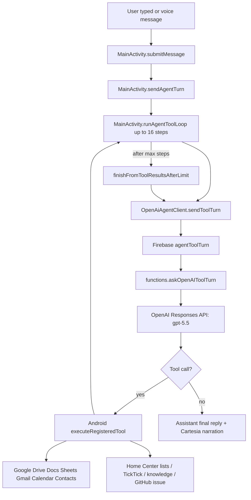
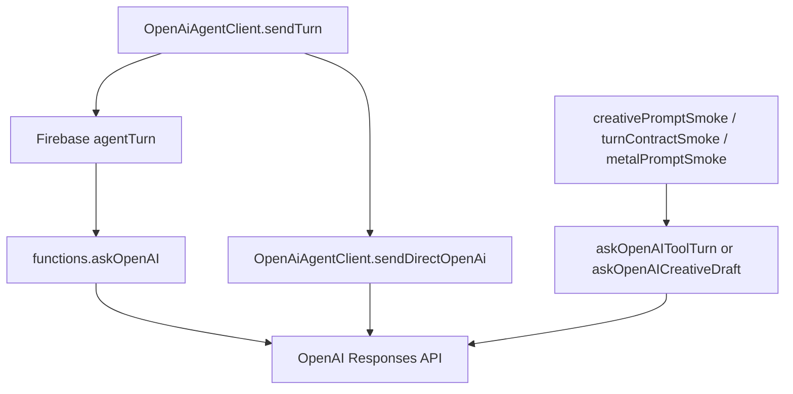

# Home Center AI Cost Audit

Date: 2026-07-05

## 1. Executive Summary

Home Center can plausibly burn OpenAI credits because the normal chat path sends nearly every user message to GPT-5.5 with medium reasoning, OpenAI web search enabled, a large fixed planner prompt, a broad tool registry, conversation context, working memory, evidence context, and tool-result history.

The cost problem is not one single large prompt. It is multiplicative:

- One user message can create several GPT calls through the Android tool loop.
- Simple deterministic commands are parsed by local code, but the current main submit path calls GPT first.
- The gateway advertises broad Google, list, GitHub, knowledge, attachment, and web capabilities together.
- OpenAI web search is enabled on normal gateway and direct fallback calls whether or not the user asked for public web.
- Long tool results can be sent back as a compact digest and again as compatibility JSON.
- Smoke/validation scripts call deployed production GPT-backed endpoints and can generate multiple expensive responses per run.
- Creative-writing recovery paths use GPT-5.5 and can perform draft plus salvage or finalization passes.

This audit does not prove the exact $90/week bill because the repo does not contain OpenAI billing export or per-request usage telemetry. It does explain where the money is going from repository evidence and local logs.

## 2. Architecture Diagram

Legacy/direct paths:

## 3. OpenAI Call Graph

### Normal Android Chat Path

| Caller | Callee | Model | Reasoning | Tools enabled | Response format | Max output | Retries/timeouts | Evidence |
|---|---|---:|---|---|---|---:|---|---|
| `MainActivity.runAgentToolLoop` | `OpenAiAgentClient.sendToolTurn` | server-controlled | server-controlled | Android sends registry JSON | JSON parsed as `ToolTurn` | server-controlled | Android read timeout 130s; loop up to 16 steps | `MainActivity.java` lines around `MAX_AGENT_TOOL_STEPS`, `runAgentToolLoop`; `OpenAiAgentClient.java` `sendToolTurn` |
| `agentToolTurn` Firebase export | `askOpenAIToolTurn` | `gpt-5.5` | `medium` | OpenAI `web_search` always enabled | strict JSON object requested | not set | Firebase timeout 120s; parse failure path | `functions/index.js` `askOpenAIToolTurn` request body |
| `askOpenAIToolTurn` after successful evidence read | `askOpenAIEvidenceFinalizer` | `gpt-5.5` | first pass `medium`, repair `low` | no tools | strict JSON final | 3200 first pass, 1800 repair | repair retry if model asks for a tool | `functions/index.js` `runEvidenceFinalizerProvider` |
| Android after tool-loop limit | `OpenAiAgentClient.sendToolTurn` with empty tools | `gpt-5.5` via gateway | `medium` in gateway | web search still enabled by gateway | final JSON expected | not set | one recovery call | `MainActivity.finishFromToolResultsAfterLimit` |

### Legacy / Fallback Paths

| Caller | Callee | Model | Reasoning | Tools enabled | Response format | Max output | Retries/timeouts | Evidence |
|---|---|---:|---|---|---|---:|---|---|
| `OpenAiAgentClient.sendTurn` | Firebase `agentTurn` | `gpt-5.5` | `medium` | OpenAI `web_search` | plain answer | not set | Firebase timeout 120s | `OpenAiAgentClient.sendTurn`; `functions.agentTurn`; `askOpenAI` |
| `OpenAiAgentClient.sendTurn` fallback | direct OpenAI Responses API | `gpt-5.5` | `medium` | OpenAI `web_search` | plain answer | not set | connect 10s, read 130s | `OpenAiAgentClient.sendDirectOpenAi` |

Important repository finding: `functions.askOpenAI()` assembles `promptText`, but the request body uses `input`. In the current source shown during audit, `input` is not defined in that function. Normal Android chat does not appear to use this path, but it is still exported as `agentTurn`.

### Creative / Smoke Paths

| Caller | Callee | Model | Reasoning | Tools enabled | Response format | Max output | Retries/timeouts | Evidence |
|---|---|---:|---|---|---|---:|---|---|
| `creativePromptSmoke` | `askOpenAICreativeDraft` | `gpt-5.5` | `low` | none | strict JSON final | 2600 | 85s first pass; salvage 25s, 1400 tokens | `functions.runCreativePromptSmoke`; `runCreativeProviderJson` |
| `askOpenAICreativeDraft` unusable output | salvage provider | `gpt-5.5` | `low` | none | strict JSON final | 1400 | second provider call | `functions.askOpenAICreativeDraft` |
| currently uncalled normal path | `askOpenAICreativeRepair` | `gpt-5.5` | `medium` | none | strict JSON final | not set | no explicit timeout | `functions.askOpenAICreativeRepair`; grep shows no current caller |
| currently uncalled normal path | `validateCreativeFinal` | `gpt-5.5` | `medium` | none | strict JSON final | not set | no explicit timeout | `functions.validateCreativeFinal`; tests assert normal gateway does not call it |
| `turnContractSmoke` | `askOpenAIToolTurn` | `gpt-5.5` | `medium` | web search in gateway | strict JSON | not set | each smoke case can call GPT | `functions.runTurnContractSmoke`; `tools/home_center_turn_contract_smoke.mjs` |
| `metalPromptSmoke` | `askOpenAIToolTurn` loop | `gpt-5.5` | `medium` | web search in gateway | strict JSON | not set | server timeout 300s; smoke loop up to 8 steps | `functions.runMetalPromptSmoke`; `tools/home_center_metal_prompt_smoke.mjs` |

## 4. Prompt Composition Analysis

Approximate token estimates use `characters / 4`. Actual billing can differ.

### Static Prompt Sizes

| Prompt section | Approx source chars | Approx tokens | Notes |
|---|---:|---:|---|
| Repo doctrine steering | 1,149 | 287 | Injected into multiple gateway prompts |
| Legacy `agentTurn` prompt source | 1,125 | 281 | Includes broad capabilities text |
| Evidence finalizer static prompt | 1,446 | 361 | Adds doctrine plus JSON/finalization rules |
| Creative repair static prompt | 1,154 | 288 | Latent/unreached path but expensive if used |
| Creative draft static prompt | 1,909 | 477 | Used by creative smoke endpoint |
| Creative validation static prompt | 1,453 | 363 | Latent/unreached path |
| `agentToolTurn` static prompt | 14,173 | 3,543 | Main cost center before runtime context |

### Runtime Prompt Caps In `agentToolTurn`

| Runtime section | Character cap | Approx token cap | Always/conditional | Evidence |
|---|---:|---:|---|---|
| Conversation summary | Android sends full stored summary; gateway trims by `safeText(..., 4000)` | 1,000 | conditional if summary present | `MainActivity.conversationSummary`; `functions.askOpenAIToolTurn` |
| Recent transcript | 4,000 from Android; gateway accepts 8,000 | 1,000-2,000 | conditional but normal after chat starts | `recentTranscriptSnapshot`; `safeText(body.transcript, 8000)` |
| Available tools JSON | 12,000 | 3,000 | always included | `Available tools JSON` |
| Unavailable tool groups JSON | 4,000 | 1,000 | always included | `Unavailable tool groups JSON` |
| Working memory JSON | 6,000 | 1,500 | always included | `Working memory JSON` |
| Attachment images JSON metadata | 3,000 | 750 | always included even when empty | `Attachment images JSON` |
| Time context JSON | 2,000 | 500 | always included | `Time context JSON` |
| Evidence context JSON | 12,000 | 3,000 | always included | `Evidence context JSON` |
| Tool evidence digest JSON | 50,000 | 12,500 | always included | `Tool evidence digest JSON` |
| Compatibility tool results JSON | 12,000 | 3,000 | conditional after tool result | `Tool results JSON retained only for compatibility` |
| Pending confirmation JSON | 4,000 | 1,000 | conditional | `Pending confirmation JSON` |
| Attached image data URLs | up to 10 images, each read from data URL capped at 15,000,000 chars | very large, image-priced | conditional | `openAiInputWithAttachments` |

Worst-case text-only `agentToolTurn` prompt can exceed 30,000 tokens before output if all runtime sections are near caps. The image path can add substantial multimodal cost.

### Duplicated Or Repeated Prompt Text

- Doctrine is injected into the main gateway planner and evidence finalizer, and equivalent doctrine is repeated in Android direct fallback.
- Tool results are sent as `Tool evidence digest JSON` and again as compatibility `Tool results JSON retained only for compatibility`.
- Tool capability descriptions are sent every planner call even when the user asks for a simple list/readback command.
- Time context, attachment metadata, working memory, and evidence context are present on every gateway call, not only when relevant.
- Web-search instruction is present in the planner prompt and OpenAI web search is enabled in the request body.
- Several creative-writing rules are in the main planner even for non-creative tasks.

### Prompt Assembled But Unused

- `functions.askOpenAI()` builds `promptText` but the OpenAI request body uses `input`. This is a legacy/exported path and should be treated as a bug and audit risk, even if normal chat bypasses it.

## 5. Model Audit

| Model | Where used | Why selected by code/docs | Justified? | Cheaper recommendation |
|---|---|---|---|---|
| `gpt-5.5` | Normal gateway planner, evidence finalizer, creative repair/draft/validation, legacy agentTurn, Android direct fallback | Product target says GPT-5.5 should own judgment | Justified for complex multi-tool planning and high-stakes writing synthesis; not justified for every confirmation, list command, or deterministic CRUD | Use cheaper/lower-reasoning model for classification, confirmations, summaries, and final success narration |
| `gpt-5.5` with `reasoning: medium` | Main planner, direct fallback, legacy agentTurn, evidence first pass, repair/validation | No per-intent differentiation | Overused for simple tasks | Default to low/minimal for single-tool routing and confirmation handling |
| `gpt-5.5` with `reasoning: low` | Creative draft/salvage | Recent mitigation for timeouts/cost | More justified than medium for prose generation if output quality is acceptable | Keep low; add max-output guardrails |
| Gemini model from `GEMINI_MODEL` | Conversation compaction only | Cheaper/local user-provided key path | Appropriate for manual compaction | Automate compaction if privacy/cost acceptable |

No code changes are made by this audit.

## 6. Tool Audit

Tools are conditionally enabled by permission/scope, not by intent.

If the Google account has scopes, `ToolRegistry.availableTools()` can advertise:

- Drive: search, metadata read, folder create, metadata update, upload, delete
- Docs: search, read, create, update, delete
- Sheets: search, read, create, update, delete
- Gmail: search, read, create/update draft, send draft, send email, trash
- Calendar: search, read, create/update/respond/delete event
- Contacts: search/read
- Lists: read/create/add/update/mark done/remove
- Knowledge: read/append
- GitHub: create issue

The OpenAI request also enables hosted `web_search` in normal gateway and direct fallback calls.

Recommendations:

- Expose a minimal default palette: final answer only, lists read/add, and maybe knowledge read.
- Add intent-scoped palettes: Google Docs palette only for document requests; Gmail only for mail; Calendar only for event/time language; GitHub only for explicit report/issue requests.
- Enable OpenAI `web_search` only when the user asks for public web/current information, public GitHub, or external docs.
- Do not advertise delete/trash tools until the latest user request contains delete/trash/remove/cancel language.
- Do not include full tool descriptions on every loop step; send tool names plus compact schemas, or cache the registry server-side.

## 7. Routing Audit

Home Center has a deterministic parser in `CommandParser`, but `submitMessage()` currently records the message and calls `sendAgentTurn(clean)` directly. That means simple commands pay GPT first.

Deterministic commands that should bypass GPT:

- `add eggs to shopping list`
- `read shopping list`
- `next`
- `previous`
- `done`
- create personal/household/group list
- remove/cross off/mark done item
- read preferences
- set grocery preference
- map Walmart SKU/target
- build/export Walmart cart
- hotspot on/off diagnostics or deterministic unsupported response

Local logs show this pattern in practice:

- `2026-06-27.txt`: 49 `Asking GPT-5.5` entries, 74 `agent_trace step=0`, 38 `step=1`, 21 Android tool executions, 48 `gpt_5_5_complete`.
- `2026-06-28.txt`: 4 `Asking GPT-5.5`, 8 `step=0`, 4 `step=1`, 4 tool executions.
- `2026-07-01.txt`: 3 `Asking GPT-5.5`, 6 `step=0`, 6 `step=1`, 9 tool executions.
- `2026-07-04.txt`: 2 `Asking GPT-5.5`, 4 `step=0`, 0 tool executions.

These counts show that one visible user turn often becomes more than one GPT planner call.

Estimate: if deterministic list/readback/navigation/status commands are 30-50% of normal family-app usage, bypassing GPT for those commands should save roughly 25-45% of normal OpenAI spend before any prompt reductions.

## 8. Conversation Audit

Current protections:

- Android stores at most `MAX_RECORDED_TURNS = 18`.
- `recentTranscriptSnapshot()` sends the latest transcript clipped to 4,000 characters.
- Gateway accepts transcript up to 8,000 characters.
- Conversation summary is stored separately and gateway accepts up to 4,000 characters.
- Manual compaction uses Gemini if configured; otherwise local fallback.

Remaining cost issues:

- Compaction is manual, not automatic.
- Summary plus recent transcript can still add roughly 2,000 tokens to every normal planner call.
- Restored conversation summary is rendered and persisted, and can remain in every later prompt.
- Evidence context is separate from transcript/summary and can add up to 12,000 chars every turn.
- Attachment text previews can be up to 20,000 chars in Android working memory/evidence paths.
- Tool evidence digest can add up to 50,000 chars after tool work.

Recommended compaction strategy:

- Auto-compact after 8-10 turns or after transcript exceeds 2,000 chars.
- Keep the normal planner transcript to the last 4-6 turns unless the user asks to recover context.
- Move long evidence into named handles, then lazy-read only when requested.
- Store stable doctrine/tool registry server-side and refer by version rather than repeating text.
- Send attached file previews only when the latest request references the file.

## 9. Top 10 Cost Leaks

| Rank | Leak | Evidence | Impact | Difficulty | Expected weekly savings |
|---:|---|---|---|---|---|
| 1 | Every normal turn uses GPT-5.5 medium with the large planner prompt | `askOpenAIToolTurn` model/reasoning/web_search; `MainActivity.submitMessage -> sendAgentTurn` | Very high | Medium | 25-40% |
| 2 | Multi-step loop multiplies calls per user request | `MAX_AGENT_TOOL_STEPS = 16`; logs show step 0 and step 1 on many turns | Very high | Medium | 15-30% |
| 3 | Deterministic commands route through GPT first | `CommandParser` exists; `submitMessage` calls `sendAgentTurn` directly | Very high | Low-medium | 20-35% |
| 4 | Full broad tool registry is advertised together | `ToolRegistry.allTools`; `Available tools JSON` cap 12k | High | Medium | 10-25% |
| 5 | Web search always enabled | `tools: [{type: 'web_search'}]` in gateway/direct requests | High | Low | 10-20% |
| 6 | Tool evidence duplicated as digest and compatibility JSON | `Tool evidence digest JSON` plus `Tool results JSON retained only for compatibility` | High on tool loops | Low | 5-15% |
| 7 | Evidence context/working memory sent every turn | 12k evidence cap, 6k memory cap | Medium-high | Medium | 5-15% |
| 8 | Confirmation and post-tool success often require another GPT call | tool loop continues after successful tool; logs show final step after tool execution | Medium-high | Medium | 5-15% |
| 9 | Production smoke scripts spend real GPT calls | turn/creative/metal smoke scripts; evidence files show 6-9 responses in some metal runs | Medium, bursty | Low | depends on frequency; 5-20% during active debugging |
| 10 | Creative/image/file paths can carry large context | creative prompts, attachment image data URLs, 20k previews | Medium, bursty | Medium | 5-15% |

Savings are estimates. They should be replaced with actual billing/usage telemetry once the gateway records prompt tokens, completion tokens, model, tool use, and request source.

## 10. Quick Wins Under One Hour

Do not implement these in this audit; they are recommendations.

- Add logging of OpenAI request source, model, reasoning, prompt char count, attachment count, tool count, tool result count, and returned usage if available.
- Disable OpenAI `web_search` unless the request needs public/current web.
- Short-circuit `next`, `previous`, `done`, `read shopping list`, and `add X to shopping list` before `sendAgentTurn`.
- Stop the post-tool GPT call for simple success messages where Android already has a deterministic result.
- Remove compatibility `Tool results JSON` once the planner reliably uses the digest.
- Put smoke scripts behind an explicit `--spend-openai` or `HOME_CENTER_ALLOW_OPENAI_SMOKE=1` gate.
- Add a report section to smoke output with number of gateway calls made.

## 11. Medium Refactors

- Introduce an intent-gated tool palette builder:
  - default: final answer and lists
  - docs/drive only for document/file language
  - gmail only for email language
  - calendar only for event/time language
  - contacts only when a person/contact is referenced
  - github only for explicit report/issue requests
- Split planning into cheap classification plus expensive tool-planning only when required.
- Add server-side registry caching: send `toolRegistryVersion` instead of full descriptions when unchanged.
- Add automatic conversation compaction and keep normal prompts to summary plus recent turns.
- Replace GPT confirmation parsing with deterministic pending-confirmation handling for `confirm create`, `confirm edit`, `cancel`, and double-confirm delete.
- Add a cost test that fails if static planner prompt or tool JSON exceeds a fixed budget.

## 12. Long-Term Architecture Improvements

- Make Android/Firebase the deterministic executor for known CRUD paths and reserve GPT-5.5 for ambiguous planning, synthesis, writing, and recovery.
- Add a small cheap router model or deterministic classifier before GPT-5.5.
- Store long context in retrievable chunks and let GPT request named context instead of always receiving it.
- Maintain per-capability prompt modules and lazy-load only the relevant module.
- Add billing-aware observability:
  - request ID
  - source endpoint
  - model
  - reasoning effort
  - tools enabled
  - input chars/tokens
  - output tokens
  - image count
  - web search enabled
  - loop step
  - user-visible task
- Separate production app traffic from smoke/test traffic by API key, project, or metadata.

## 13. Estimated Weekly Savings Summary

If implemented together, these changes are not additive because they overlap. A realistic staged estimate:

| Package | Expected savings |
|---|---:|
| Deterministic local bypass for lists/navigation/confirmations | 25-45% |
| Disable default web search and intent-scope tools | 15-35% |
| Reduce planner prompt and remove duplicated tool evidence | 10-25% |
| Auto-compact/lazy-load transcript, evidence, and attachments | 10-25% |
| Gate or separate GPT-backed smoke tests | 5-20% during active debugging weeks |
| Use cheaper/lower-reasoning models for classification and simple finalization | 15-40% |

For a $90/week baseline, a conservative combined reduction is 40-60% after quick wins and medium refactors, or roughly $36-$54/week saved. A more aggressive architecture that routes deterministic tasks away from GPT-5.5 and reserves GPT-5.5 for complex planning/writing could plausibly save 60-80%, or roughly $54-$72/week.

## 14. Evidence Appendix

Primary files inspected:

- `functions/index.js`
  - `OPENAI_API_KEY`, `CREATIVE_OPENAI_TIMEOUT_MS`, `HOME_CENTER_DOCTRINE_STEERING`
  - `askOpenAI`
  - `askOpenAIEvidenceFinalizer`
  - `askOpenAICreativeRepair`
  - `askOpenAICreativeDraft`
  - `validateCreativeFinal`
  - `askOpenAIToolTurn`
  - `runMetalPromptSmoke`
  - `runCreativePromptSmoke`
  - `runTurnContractSmoke`
  - exports: `agentToolTurn`, `agentTurn`, `creativePromptSmoke`, `turnContractSmoke`, `metalPromptSmoke`
- `app/src/main/java/com/dclar/homecenter/OpenAiAgentClient.java`
  - `sendTurn`
  - `sendToolTurn`
  - `sendDirectOpenAi`
  - `buildDirectPrompt`
- `app/src/main/java/com/dclar/homecenter/MainActivity.java`
  - `submitMessage`
  - `sendAgentTurn`
  - `runAgentToolLoop`
  - `finishFromToolResultsAfterLimit`
  - `compactConversation`
  - `recentTranscriptSnapshot`
- `app/src/main/java/com/dclar/homecenter/ToolRegistry.java`
  - tool list and scope-gated availability
- `app/src/main/java/com/dclar/homecenter/CommandParser.java`
  - deterministic commands currently available locally
- `tools/home_center_turn_contract_smoke.mjs`
- `tools/home_center_creative_prompt_smoke.mjs`
- `tools/home_center_metal_prompt_smoke.mjs`
- Local logs under `/storage/emulated/0/Download/HomeCenter/logs`
- Smoke evidence under `tools/creative_prompt_evidence` and `tools/metal_prompt_evidence`

